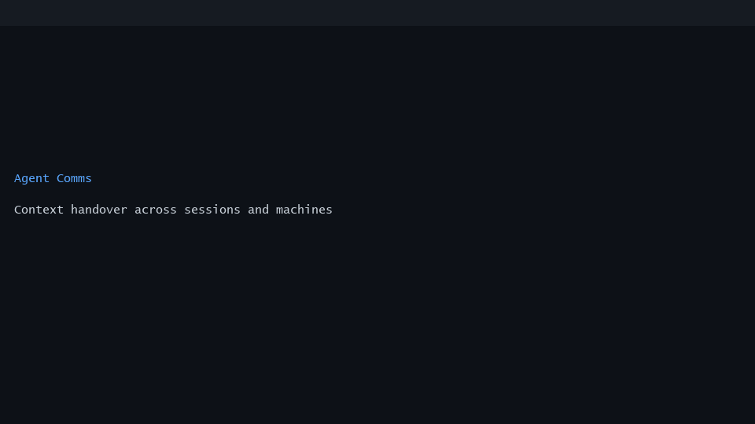
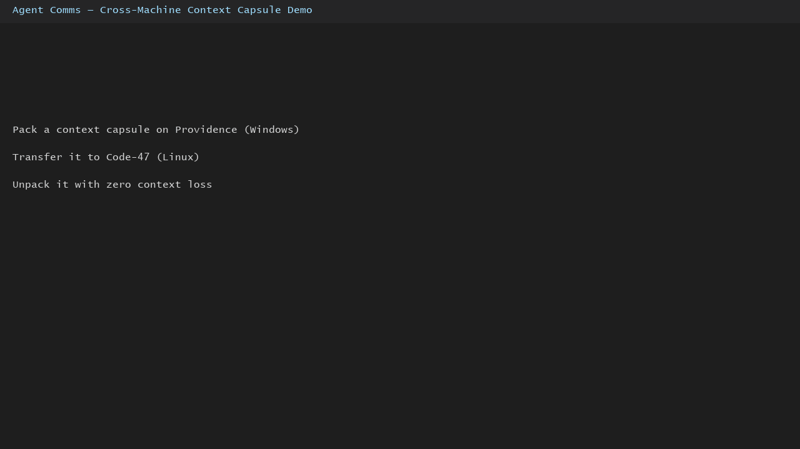

# Agent Comms

[](https://github.com/BlahBlah23406/agent-comms/actions/workflows/tests.yml)
[](setup.py)
[]()

> A lightweight protocol and toolkit for AI coding agents to share context, hand off tasks across sessions, and collaborate in real-time across machines.



---

## TL;DR

Agent Comms lets AI coding agents (Claude, Antigravity, Cursor, OpenClaw) share working memory across sessions and machines. Pack a context capsule on one computer, resume on another — no context lost.

---

## What It Is

When working with AI coding agents (Claude Desktop, Antigravity, Cursor, OpenClaw, etc.), two major challenges arise:
1. **Context Loss Across Sessions:** Starting a new chat or moving to another machine resets the agent's mental model and working memory.
2. **Multi-Agent Coordination:** Agents running in different environments or physical computers cannot easily communicate, exchange state, or run coordinated tasks.

**Agent Comms** provides a unified solution:
- **Context Capsules (Out-of-Session Handoff):** Packages an agent's task roadmap, architectural decisions, rejected hypotheses, and uncommitted git diffs into a compact, portable bundle. The next agent session resumes immediately without burning context tokens.
- **Unified Capsule Storage Server:** A central persistent storage hub (e.g. running on a cloud VM or companion station like `code-47` over a private Tailscale network) where all fleet agents automatically upload, query, pull, and synchronize capsules.
- **AHRP Live Relay (In-Session Collaboration):** A real-time WebSocket mesh supporting peer discovery, publish/subscribe messaging, and cross-machine Remote Procedure Calls (RPC).
- **Native MCP Integration:** Works out-of-the-box with Claude Desktop, Antigravity, OpenClaw, and Cursor via the Model Context Protocol.

---

## The Engineering Story

The problem hit me every time I started a fresh agent session: hours of reasoning — rejected paths, working hypotheses, uncommitted diffs — vanished the moment the chat reset or I switched machines. Existing tools saved *code*, but they didn't save the *mind* behind it. I kept losing the cognitive thread.

The breakthrough was separating **cognitive state** from the git tree. A git stash stores a patch; a **Context Capsule** stores the patch *plus* the roadmap, the dead ends, and the exact next step. That single shift turned a resume from "figure it out again" into "continue immediately."

Once capsules solved handoff, I wanted agents to talk *while* they worked. **AHRP Live Relay** gives them a real-time WebSocket mesh: peer discovery, shared beliefs, and direct RPC across machines. Two agents on different computers can literally negotiate a contract and adapt each other's pipelines without human intervention.

With v1.1, we introduced **Unified Capsule Storage**: instead of manual file copies or fragmented local stores, a designated companion machine (such as `code-47` over Tailscale) hosts a unified storage server. All agents automatically sync save-states, making context accessible instantly on command and automatically on any node.

---

## Cross-Machine Demo

The video below shows a real capsule packed on **Providence (Windows)** and unpacked on **Code-47 (Linux)** with zero context loss.



**What happens:**
1. On Providence, `agent-comms capsule pack` creates `DEMO-01` with a summary, next step, and epistemic learning.
2. The capsule is automatically synced to the Unified Storage Server on Code-47 over Tailscale.
3. On Code-47, `agent-comms capsule unpack DEMO-01` restores the exact task briefing — task ID, summary, next action, and learning all intact.

This is the out-of-session handoff problem solved end-to-end across two physical machines.

---

## How It Works

### 1. Unified Capsule Storage & Handoff
Agent Comms captures cognitive state alongside your working tree without polluting Git commit history:
- **State & Decisions:** Records what worked, what was rejected, and the immediate next steps.
- **Code Diffs:** Captures staged, unstaged, and untracked changes into a clean patch.
- **Briefing Generation:** Produces a token-efficient Markdown briefing tailored for the incoming agent.
- **Unified Fleet Storage:** Agents push to and pull from a centralized storage server (e.g. `http://code-47:8765`), keeping all machines in sync.

```
Machine A (Active Session)              Unified Storage (Code-47)            Machine B (New Session)
 ┌──────────────────────────┐               ┌───────────────────┐               ┌──────────────────────────┐
 │ Agent exports capsule    │────[Upload]──▶│ Central Capsule   │────[Download]▶│ Agent imports capsule    │
 │ (diffs + state + roadmap)│               │ Persistent Store  │               │ (restores diffs + state) │
 └──────────────────────────┘               └───────────────────┘               └──────────────────────────┘
```

### 2. In-Session Collaboration (Live Relay Mesh)
For multi-agent workflows, a lightweight relay server coordinates agents over WebSockets:
- **Peer Discovery:** Agents announce presence, roles, and hardware capabilities.
- **Cognitive Blackboard:** Replicated state where agents share real-time decisions and learnings.
- **Direct RPC:** Agents can invoke tools or run commands on peer machines.

---

## How to Get It

### Installation

**Using Pip:**
```bash
pip install git+https://github.com/BlahBlah23406/agent-comms.git
```

**Or Clone & Install Locally:**
```bash
git clone https://github.com/BlahBlah23406/agent-comms.git
cd agent-comms
pip install -e .
```

**One-Line Install Script:**
- **macOS / Linux:**
  ```bash
  curl -sSL https://raw.githubusercontent.com/BlahBlah23406/agent-comms/main/install.sh | bash
  ```
- **Windows (PowerShell):**
  ```powershell
  irm https://raw.githubusercontent.com/BlahBlah23406/agent-comms/main/install.ps1 | iex
  ```

Run initial setup:
```bash
agent-comms setup
```

---

## Quick Usage

### 1. Save Progress (Create a Capsule)
Before ending a session or switching computers:
```bash
agent-comms capsule pack \
  --task "AUTH-01" \
  --summary "Migrated auth module to JWT; integration test pending" \
  --next "Run pytest tests/test_auth.py" \
  --learning "finding:PyJWT requires algorithms=['HS256']" \
  --sync
```

### 2. Unified Capsule Storage Server (Central Hub)
Run a unified persistent capsule storage server on your companion host (e.g. `code-47`):
```bash
# Start storage server on host
agent-comms storage server --host 0.0.0.0 --port 8765 --dir ~/.agent-comms/capsules

# Point client machines to the unified storage server (over Tailscale or LAN)
agent-comms config set storage_server_url "http://100.118.132.56:8765"
agent-comms config set auto_sync_storage true

# Push / Pull / Sync capsules
agent-comms storage push "AUTH-01"
agent-comms storage pull "AUTH-01" --apply
agent-comms storage sync
agent-comms storage list --remote
```

### 3. Resume on Another Machine
Restore your uncommitted files and task briefing:
```bash
agent-comms capsule unpack "AUTH-01"
```
*(If the capsule isn't stored locally, it is automatically fetched from the unified storage server.)*

### 4. Cloud Capsule Synchronization
Save capsules to external cloud providers (S3, GCS, Azure, GitHub Gists) or the unified storage server:
```bash
# Push capsule to GitHub Gist or AWS S3
agent-comms capsule push "AUTH-01" --cloud github
# or
agent-comms capsule push "AUTH-01" --cloud s3

# Pull and immediately apply patch on another machine
agent-comms capsule pull "AUTH-01" --cloud github --apply
```

### 5. 1-Command Active Cross-Session (Instant Auto-Wake)
Work from one machine and activate the rest with zero manual network setup:
- **On secondary machine (e.g. Desktop / Cloud GPU rig):**
  ```bash
  agent-comms standby
  ```
- **On primary machine (e.g. Laptop):**
  ```bash
  agent-comms session start --target desktop --capsule "AUTH-01"
  ```
*Machine A automatically discovers Machine B over LAN, sends a wake-up signal, transmits the workspace capsule, and links both into an active real-time cross-session.*

### 6. Preemptive AI Rate-Limit & Quota Guard
Never lose your work or get stuck mid-task due to AI provider quota exhaustion or rate limits:
- **Autonomous SessionWatchdog:** Runs inside the background standby daemon, actively watching Claude Code and Antigravity logs for rate-limit pauses or 429 exhaustion, and auto-generates an evacuation capsule.
- **Claude Code Lifecycle Hooks:** Integrates deterministic `PreToolUse` and `Stop` hooks in `settings.json` to capture state immediately before a session is blocked.
- **Workspace Briefing:** Writes `PREEMPTIVE_EVACUATION_BRIEFING.md` directly in the project root with the exact resumption prompt for successor models.

```bash
# Check current AI provider quota usage & remaining headroom
agent-comms quota status --provider anthropic

# Run session watchdog in foreground (already active in background standby)
agent-comms quota watch

# Preemptively evacuate session before rate limit lockout
agent-comms quota evacuate --task "AUTH-01" --target gemini
```

### 7. Multi-Machine Node Setup (`--alias`)
Set up any machine in 1 command and automatically link it to your peer network:
```bash
# On primary laptop:
agent-comms setup --alias laptop --peers laptop,desktop-gpu,code-47

# On secondary/remote machine (with auto-wake background standby service):
agent-comms setup --alias desktop-gpu --peers laptop,desktop-gpu,code-47 --standby
```

### 8. Run the Live Collaboration Demo
See two local agents discover each other and collaborate:
```bash
agent-comms demo
```

### 9. Use in Claude Desktop, Claude Code, Antigravity, OpenClaw, or Cursor (MCP)
Agent Comms includes full MCP tooling for Context Capsules, Unified Storage, Cloud, Active Cross-Sessions, and Quota Protection:
- `export_handoff_capsule` (with automatic storage server upload)
- `import_handoff_capsule` (with automatic remote fallback)
- `sync_capsules` (synchronizes local and unified storage)
- `push_handoff_capsule` & `pull_handoff_capsule` & `list_saved_capsules`
- `start_cross_session` & `scan_network_peers`
- `check_quota_status`, `record_usage_and_guard`, & `preemptive_quota_evacuate`

Add to your MCP settings file:
```json
{
  "mcpServers": {
    "agent-comms": {
      "command": "agent-comms",
      "args": ["mcp"],
      "env": {
        "AGENT_COMMS_STORAGE_URL": "http://100.118.132.56:8765"
      }
    }
  }
}
```

Once added, interact naturally with your agent:
> *"Save my progress into a handoff capsule for task AUTH-01."*  
> *"Resume task AUTH-01 from my latest capsule."*  
> *"Sync our capsules with code-47 storage server."*  
> *"Start an active cross-session with code-47 for task PERF-99."*  
> *"Check our quota status and evacuate to Gemini if we are close to Claude's rate limit."*

---

## Documentation

- [**Natural Language User Guide** (`USER_GUIDE.md`)](USER_GUIDE.md) — Plain-English prompt examples for Claude Desktop, Claude Code, Antigravity, and Cursor.
- [**Onboarding Guide** (`ONBOARDING.md`)](ONBOARDING.md) — Step-by-step developer onboarding and distributed agent recipes.
- [**Protocol Specification** (`SPECIFICATION.md`)](SPECIFICATION.md) — Formal AHRP wire protocol and JSON schemas.
- [**Tutorial & Recipes** (`TUTORIAL.md`)](TUTORIAL.md) — Hands-on walkthroughs and implementation examples.
